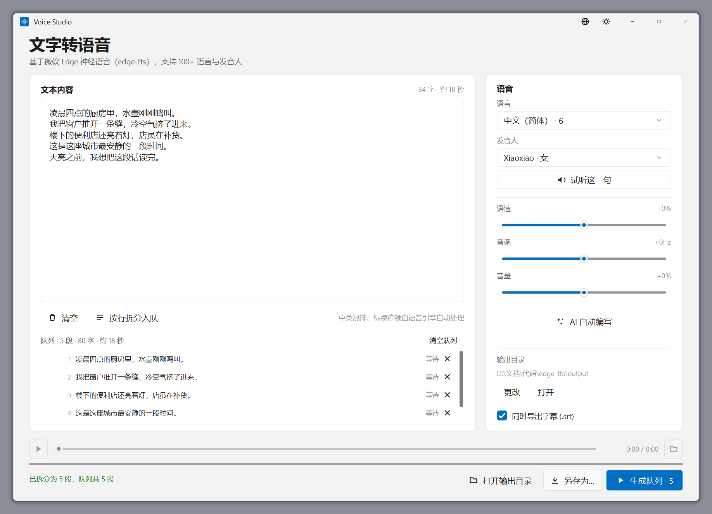
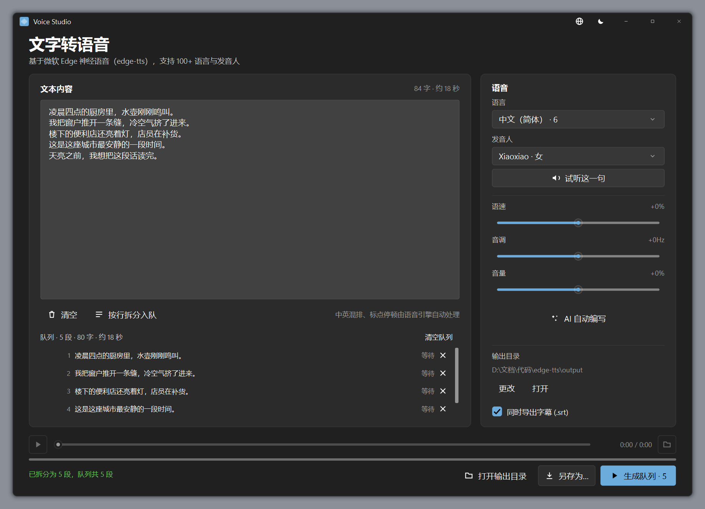
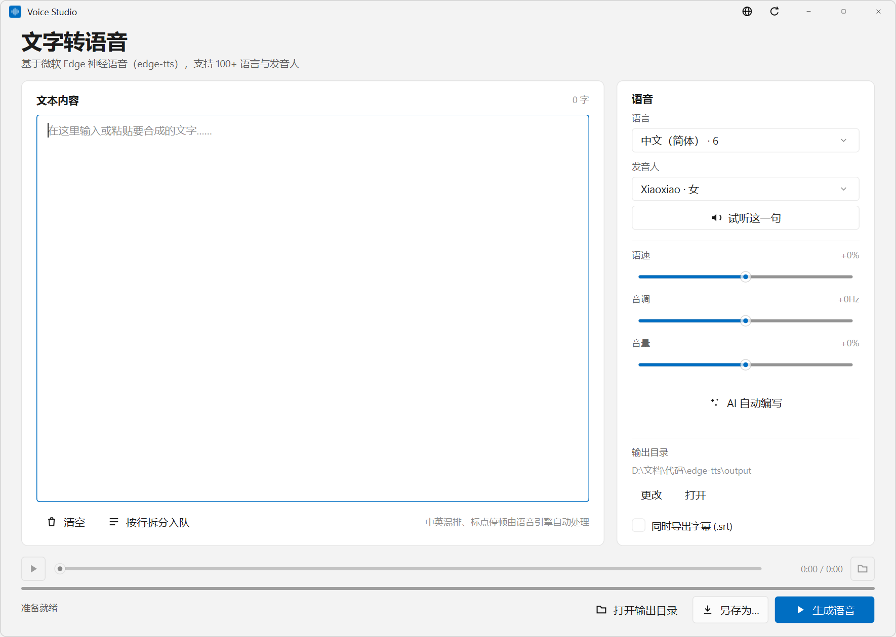
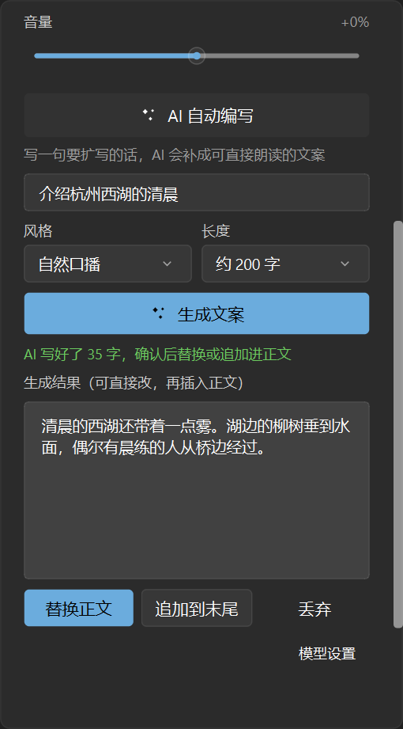
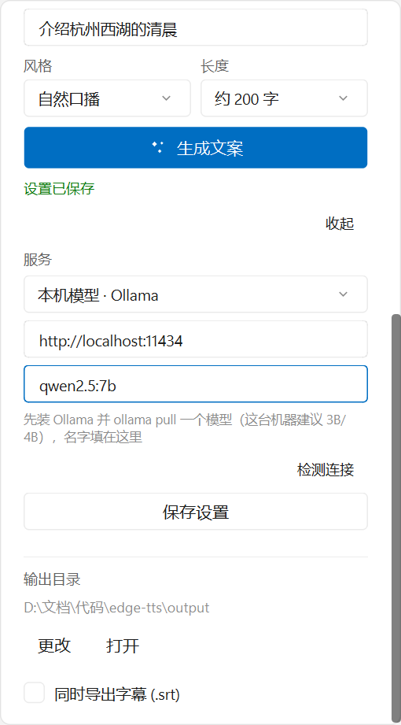
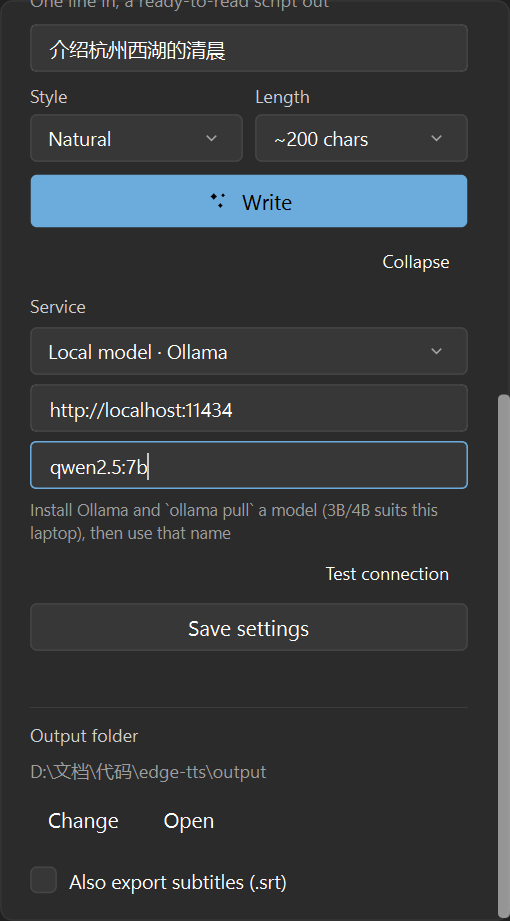
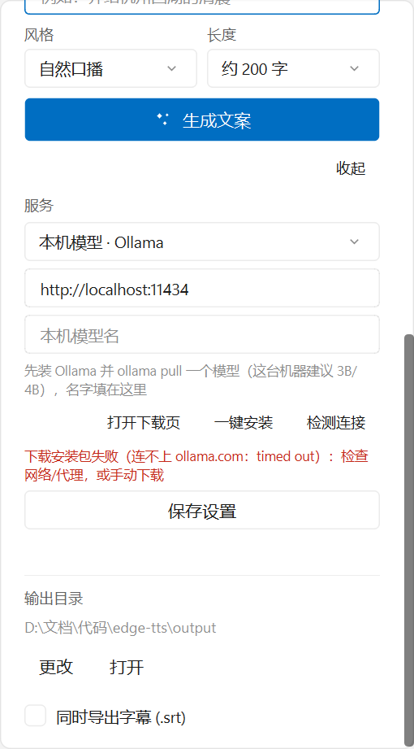

# 文字转语音 · Voice Studio

用 Python 写的 Windows 11 桌面 TTS 工具：**PySide6 自绘 WinUI 3 风格界面 + 微软 Edge 神经语音（edge-tts）**。
输入文字 → 选发音人 → 调语速/音调/音量 → 生成 MP3（可选同时导出同名 SRT 字幕）→ 内置播放器直接试听；
也可按行拆成队列批量生成一整篇。




---

## 快速开始

```powershell
pip install -r requirements.txt
python main.py
```

也可以双击 `run.bat`（等价于在项目目录执行 `python main.py`）。

> 本机当前环境已验证：Python 3.13 + PySide6-Essentials 6.12 + edge-tts（已安装）。
> **只需要 `PySide6-Essentials`**，因为播放走的是 Windows 原生 MCI，不需要 QtMultimedia / PySide6-Addons。

## 打包成 exe（目标电脑不用装 Python）



双击 `build_exe.bat`（或执行下面的命令），产物是 **`dict\VoiceStudio.exe`**，单文件、不带控制台黑窗：

```powershell
python -m PyInstaller --noconfirm --clean --windowed --onefile `
  --name "VoiceStudio" --icon "assets\app.ico" `
  --distpath "dict" --workpath "build" --specpath "build" `
  --collect-submodules edge_tts main.py
```

拿到的 `VoiceStudio.exe` 拷到任何 64 位 Windows 10/11 上双击即可，**不需要 Python 和 PySide6**。

几点要知道：
- 单文件模式每次启动会先把内部文件解到临时目录，冷启动大约 2–4 秒，之后窗口才出来，属正常；
- 成品、配置、缓存的位置：成品默认落在 **exe 同目录的 `output\`**；配置与语音缓存仍在 `%LOCALAPPDATA%\EdgeTTSStudio\`。
  如果这台机器之前用源码跑过，`settings.json` 里记着旧的输出目录会继续生效，点面板里的「更改」重设即可；
- 程序本身不带控制台，万一启动出错看不到报错：异常会写进 `%LOCALAPPDATA%\EdgeTTSStudio\crash.log`；
- 合成音频仍然要联网（微软语音服务）；「AI 自动编写」的方舟通道要 Key、本机通道要先装 Ollama；
- 换图标就替换 `assets\app.ico`（现在是强调色圆角方块 + 白色声波，多尺寸 16–256）。

## 功能

| 功能 | 说明 |
| --- | --- |
| 在线语音库 | 启动后异步拉取 edge-tts 全部发音人（本机实测 322 个 / 142 种语言），语言下拉里直接标注每种语言的人数（如「中文（简体） · 6」），缓存到本地 |
| 试听 | 朗读输入框里的整段文字；超过 300 字时按句末标点截断（不会从词中间切开），并提示实际朗读了多少字 |
| 离线兜底 | 断网或首次启动时用内置的 50 个常用发音人，界面不空窗 |
| 合成 | 流式接收音频，按 SentenceBoundary 事件回传真实进度，可随时取消 |
| 字幕 | 勾选「同时导出字幕」后，与 MP3 同名写入 `.srt`，按句对齐，可直接拖进剪辑软件 |
| 批量队列 | 一段文字按行拆成多条，逐段生成、逐段显示状态；单段失败不影响后面的段；文件名带 `001_` 序号 |
| 队列内试听 | 每段生成成功后，行首出现播放按钮；点它先停掉当前试听，再用底部那条播放条放这一段（同一条再点一次就是暂停/继续）。正在播的那一行铺淡强调色、按钮转成暂停图标 |
| AI 自动编写 | 语音卡片里「音量」下面那条「AI 自动编写」按钮，点开就是一块面板：写一句短话 → 选风格（自然口播/故事感/科普讲解/宣传文案）和目标长度（100/200/300/500 字）→ 扩写成可直接朗读的文案，先看结果，再点「替换正文」或「追加到末尾」。服务可切**火山方舟（豆包）**或**本机 Ollama**（免费、不联网，带「检测连接」列模型和「一键安装」下官方安装包） |
| 快捷键 | `Ctrl+Enter` 生成、`空格` 播放/暂停（文本框里不抢空格）、`Esc` 取消/停止（菜单或确认卡片开着时先收它们） |
| 清空确认 | 「清空」和队列的「清空队列」都先在按钮旁展开一张确认卡片（窗口内浮层，不是系统对话框），确认后才动手；`Esc` 或点卡片以外的地方即取消，没有内容时不弹；两张卡片不会同时挂着 |
| 拖拽导入 | 把 `.txt` / `.srt` / `.md` 拖进窗口即可导入，追加到文本末尾；SRT 自动剥掉时间轴与序号 |
| 播放 | 内置播放条（播放/暂停、拖动定位、时长），底层是 winmm MCI，复用系统 MP3 解码器 |
| 界面语言 | 标题栏「主题按钮左侧」的地球按钮 → 弹出小菜单选中文 / English，整窗文案（含输入框右键菜单、状态栏、确认卡片、队列行）一起换，选择会落盘 |
| 朗读跟随高亮 | 播放时正文里「正在读的那一句」实时铺上强调色，并自动滚到可见区；播完 / 换音频 / 改正文自动收起 |
| 参数 | 语速 −50%~+50%、音调 −50~+50Hz、音量 −50%~+50% |
| 输出 | 自动命名存到 `output/`，也可「另存为」指定路径；一键打开输出目录 |
| 记忆 | 上次的语言/发音人/参数/主题/界面语言/输出目录/是否导出字幕，以及 AI 面板的风格、目标长度与模型配置都会记住 |

## 字幕导出（SRT）

在语音卡片底部勾选「同时导出字幕 (.srt)」，点「生成语音」后会在 MP3 旁边写一份同名 `.srt`：

```srt
1
00:00:00,100 --> 00:00:03,988
第一句话，用来测试字幕的第一条时间轴。

2
00:00:03,988 --> 00:00:12,512
第二句稍微长一点，包含逗号、顿号，还有句号，
看看折行会不会把标点丢到下一行开头。

3
00:00:12,512 --> 00:00:17,400
第三句 English words mixed
in 中文，验证中英混排。
```

时间轴取自微软 Edge 语音引擎的 **SentenceBoundary 事件**（`offset`/`duration` 单位 100ns），
一个事件就是一句完整的、带标点的话，所以不需要自己断句。生成规则（`subtitles.py`）：

- **裁重叠**：相邻事件的首尾会重叠几十毫秒（实测第 1 句 5,012 结束、第 2 句 4,962 开始），
  官方 `SubMaker` 直接拼会导致两条字幕同时压屏；这里把上一条的结束时间裁到下一句起点。
- **折行**：超过 44 个显示单位（全角按 2 算，约 22 个汉字）时折成两行，优先在 `，、；：！？` 或空格处断开。
- **编码**：UTF-8 **带 BOM** + CRLF 换行。Windows 上的老播放器/部分剪辑软件靠 BOM 判断编码，没 BOM 中文会乱码。
- **兜底**：空句跳过；短于 0.12 秒的字幕补到 0.12 秒；写字幕失败不影响音频本身成功。

## 批量队列

一段一篇太慢时用这个：编辑器里一行一段，点工具栏的 **「按行拆分入队」**，文本变成下方面板里的队列，
再点主按钮（此时文案变成 `生成队列 · N`）依次合成。

拆分规则（`batch.py`，纯逻辑、可脱离界面单测）：

- **每行一段**，空行自动跳过（可以放心把段之间留空）。
- **单段超过 300 字**时按句末标点 `。！？!?…` 继续切，切不动才硬切，内容不丢。
- 段内的引号/括号收尾字符不会让断句错位（`他说："你好。"` 整段算一句）。

生成行为：

- **依次合成、不并发**：上一段的线程结束了才起下一段，避免多线程抢同一个播放器/临时文件。
- **文件名带序号**：`001_段首摘要.mp3`，摘要取前 14 个字符（去掉 `\ / : * ? " < > |`，末尾标点也去掉）。
  序号保证在剪辑软件里按文件名排序就是播放顺序；同名已存在时自动追加 `(2)`、`(3)`，不覆盖旧文件。
- **字幕跟随**：勾了「同时导出字幕」时每段都写同名 `.srt`，与 mp3 一起排在同一目录。
- **失败不中断**：某段报错（网络抖动、单段内容被拒）只会让那一行变红显示「失败」，队列继续往下跑，
  结束时状态栏汇总「成功 X，失败 Y（第 N 段：原因）」。
- **取消**：任何时刻点「取消生成」，当前段停掉、剩余段保持「等待」状态，可以直接再点一次接着跑已完成的剩下的；
  已完成的那几段不会重做。
- **进度**：底部进度条显示的是整队进度（`(已完成段数 + 当前段百分比) / 总段数`），状态栏写「正在生成第 i/N 段 · x%」。
- **行内试听**：某段变「已完成」且文件还在时，行首出现播放按钮（22×22，和行号共处同一列，未生成的段也占着这列，列表不会参差）。
  点它就停掉当前试听、用底部那条播放条放这一段——播放条不区分「试听」与「队列」，共用同一个 MCI 播放器与同一组控件，
  所以进度、时长、`空格`、`Esc`、「用系统播放器打开」全部自然生效。同一条再点一次 = 暂停/继续；
  正在播的那一行铺一层淡强调色（alpha 保底 0x24），按钮图标切成暂停并转强调色。

队列只在内存里，**关掉窗口就清空**（不会存进 settings.json）。生成完的文件都在输出目录，可以一次「打开输出目录」查看。

## 快捷键与拖拽导入

| 操作 | 说明 |
| --- | --- |
| `Ctrl+Enter`（小键盘 `Ctrl+Return` 同样有效） | 生成语音。焦点在输入框里也生效，写完直接按就行 |
| `空格` | 播放 / 暂停。只在焦点**不在**输入类控件（文本框、下拉框、按钮、数值框）上时才接管，所以在文本框里打字，空格仍然是空格 |
| `Esc` | 有自绘菜单 / 确认卡片开着 → 先收它们（不会顺手停播放）；否则正在合成或队列在跑 → 取消；都没有就停止播放 |
| 拖 `.txt` / `.srt` / `.md` 进窗口 | 内容进入文本区；拖进来时会浮出一层提示，松手即导入 |

拖拽的两条约定：

- **追加而不是覆盖**：文本区里已有内容时，新内容接在末尾（中间空一行），状态栏写「已追加导入 …（原有内容已保留）」。一次误拖就把写了半天的稿子冲掉是不能接受的；真要换内容，先点「清空」。
- **一次只导入一个**：拖了多个文件时只取第一个，状态栏会说明另外几个被忽略。

提示层的两个小细节（都是踩坑改出来的）：**拖到正文区也走整窗导入**（文本框关掉了自己的拖拽，否则 Drop 被它接走，主窗口收不到、提示层就一直挂着），**拖拽中途取消也能自己收掉**（松手后若一条 drop/leave 都没给，看门狗按真实按键状态在 0.5 秒内收尾）。

文件解析放在独立模块 `importer.py`（纯逻辑，可用断言直接测）：

- **猜编码**：`utf-8-sig` → `utf-8` → `gb18030`，中文记事本存的 GBK 也能读；都失败时按 UTF-8 替换解码兜底，宁可个别字符变 `?` 也不整段读不出来。
- **SRT 只留台词**：剥掉时间轴和纯数字序号行、去掉 `<i>` / `<font>` 标签与 `{\an8}` 定位、还原 `&nbsp;`；跨行字幕并成一句（英文跨行补空格，中文不补，避免「你 好」）；每条字幕留一行，正好配合「按行拆分入队」。
- **Markdown 去掉标记**：标题井号、强调符号、`[文字](链接)` 只留文字，不会把 URL 念出来。
- **失败有明确文案**：不支持的扩展名、空文件、读不了（没权限 / 被占用）分别给不同提示，并且**不动**文本区现有内容。

## 发音人列表

语音卡片里「语言」和「发音人」都是下拉框：先选语言，下面的发音人列表只显示该语言的音色；
语言下拉第一项是「全部语言 · 322」，选了就能在全部 322 个音色里挑，条目后面自动补语言名
（如「Xiaoxiao · 女 · 中文（简体）」），避免同名音色分不清。

另外，语音卡片的内容高度比窗口高时会自己出细滚动条（缩到最小尺寸 1000×680 就能看到），
不会再出现控件被压扁、互相叠住的情况。默认 1180×840 下放得下，不出现滚动条。

## AI 自动编写（火山方舟 / 本机 Ollama）

「音量」滑杆下面那条 **✦ AI 自动编写** 按钮就是入口（正好占住删掉搜索框后空出来的位置）。
点一下在卡片里展开面板，再点一下（或按 `Esc`）收起。




**用法**

1. 在面板第一行写一句短话，比如「介绍杭州西湖的清晨」；
2. 选风格：自然口播 / 故事感 / 科普讲解 / 宣传文案；选长度：约 100 / 200 / 300 / 500 字；
3. 点「生成文案」，等它写完（面板里会显示「正在写…」）；
4. 结果出现在下方只读框里——**先看，再决定**：点「替换正文」（可撤销）或「追加到末尾」（自动补空行分隔），
   也可以点「丢弃」；插入成功后面板自动收起，并回一条状态提示。

提示词是写死的：只输出正文、不要标题和分点、不要 Markdown、口语化短句、保留原意、不编造具体数字与人名。

**两条通道，在「模型设置」里切**




| 服务 | 要准备什么 | 适合 |
| --- | --- | --- |
| 火山方舟 · 豆包（默认） | 账号 + API Key + 推理接入点 ID，需联网、按 token 计费 | 在意文案质量，机器一般 |
| 本机模型 · Ollama | 装 Ollama、`ollama pull` 一个模型，不用 Key、不联网、免费 | 不想注册账号、文本不想出本机 |

**火山方舟怎么配**

1. 在[火山方舟控制台](https://console.volcengine.com/ark)开通豆包模型服务，创建一个**推理接入点**，
   拿到 `ep-` 开头的那串 ID；
2. 「服务」选「火山方舟 · 豆包」，填：服务地址（默认 `https://ark.cn-beijing.volces.com/api/v3`，换地域才需要改）、
   API Key、接入点 ID（也可以直接填模型名，如 `doubao-seed-1-6-250615`）；
3. 点「保存设置」。Key 也可以放环境变量 `ARK_API_KEY`，环境变量优先于设置里的值。

**本机 Ollama 怎么配**


1. 到 [ollama.com](https://ollama.com/download) 装好 Ollama（Windows 装完会开机自启并在托盘常驻）；
   **懒得上网页就点面板里的「一键安装」**：它从官方地址把 `OllamaSetup.exe` 下到临时目录（有百分比进度、可点「取消下载」），
   下完自动拉起安装向导，你按提示点几下装完即可；下载会顺手读 Windows 的系统代理（Clash 之类开的代理能直接用），
   直链还是下不动（国内网络常见）时会多出一个「打开下载页」，用浏览器（能走代理/VPN）下好再双击：

   
2. 拉一个模型，例如 `ollama pull qwen2.5:7b`（这台机器是核显，建议先试 3B/4B，7B 会偏慢）；
3. 「服务」选「本机模型 · Ollama」，本机地址默认 `http://localhost:11434`，
   点「检测连接」——连上会把已装模型名列出来，并自动填第一个到「本机模型名」；
4. 点「保存设置」，之后正常「生成文案」。模型名也可以手填（就是 `ollama list` 看到的名字）。

装好并连上之后，「一键安装」按钮会自动收起来，只留「检测连接」。

**出了错会怎么说**

| 情况 | 面板里的提示 |
| --- | --- |
| 没填 Key / 接入点 | 分别提示去「模型设置」补哪一项，并说明 `ep-` 开头才是接入点 |
| 401 / 403 | API Key 不对或没权限（检查 Key 完整性与模型是否已开通） |
| 404（方舟） | 接入点不存在（确认填的是推理接入点而不是模型显示名） |
| 429 | 请求太频繁被限流，等十几秒再点 |
| 5xx / 超时 / 断网 | 服务端出错、60 秒没返回、连不上服务（附默认服务地址，方便核对代理） |
| 本机连不上 | 指向「装 Ollama + `ollama serve` 在跑」，并附当前本机地址 |
| 安装包下载失败 | 提示 HTTP 状态/连不上 ollama.com，并露出「打开下载页」用浏览器下 |
| 本机模型不存在（404） | 提示先 `ollama pull 同一个名字` |
| 本机内存不够（5xx） | 提示换更小的模型（如 3B） |

**边界**

- 方舟通道需要联网；两条通道都是**非流式**的一次性返回（等模型写完才显示），不做逐字打字机效果；
- 本机通道的速度完全看机器：核显跑 7B 大约每秒几个字，等两分钟还没写完会提示换小模型；
- 生成期间可以照常试听、合成语音，只是不能重复点「生成文案」；
- 方舟 Key 明文存在 `%LOCALAPPDATA%\EdgeTTSStudio\settings.json`；不想落盘就用 `ARK_API_KEY` 环境变量；
- 没配置时按钮照样能点：本机模型没填会直接把「模型设置」展开并聚焦到该填的框，不会静默失败。

## 朗读跟随高亮

播放（生成完自动播、点播放键、拖动进度、试听）时，正文里**正在读的那一句**会被铺上一层强调色底，
并且自动滚到可见区，不用一边听一边自己找读到哪了。

- **高亮不动正文**。用的是 `QTextEdit.ExtraSelection` + `setBackground`，只影响绘制：
  不改字符格式、不进 undo 栈、不移动光标、不抢焦点，你原来选中的文字还在。换主题时跟着换色。
- **底色比常规强调色浓**。设计令牌里的 `accent_subtle` 是 18% 透明度，铺在白底上几乎看不出来，
  所以保底抬到 22%（深色下同一浓度，观感更明显）。
- **只有换句才动界面**。播放器每 120ms 报一次位置，同一句里连报十几次也只算一次；
  已经在可视区里的句子不会硬滚（`reveal_position` 先判断是否越界），连续播放时画面是稳的。
- **对位靠时间轴，与是否导出字幕无关**。时间轴取自合成时 `SentenceBoundary` 事件
  （`SynthJob.cues`），勾不勾「同时导出字幕」都有。
- **收起时机**：播完、换一份音频、编辑正文（正文一变旧映射就作废，避免高亮落在错的句子上）。

对位逻辑在独立模块 `follow.py`（纯逻辑、不依赖 Qt，可单独跑断言）：先把正文按句末标点
（`。！？!?…；;`，含收尾引号/括号）和换行切句，**分句数与时间轴条数一致就按顺序 1:1 对位**
（这样重复句「谢谢大家。」出现两次也不会都落到第一句）；条数对不上时才退回
「顺序找前缀、再扩到它所在的整句」。正文里的连续空白、零宽空格会先规范化成一个空格，
匹配时空白按「可有可无」处理，所以字幕那边折行、压缩空白都不影响。

时间判定有两个容差：句与句之间常有几十毫秒空隙（沿用上一句，避免闪一下），
音频开头常有静音（实测第一句起点 0.1s，`head_grace` 1 秒内都算第一句，所以一载入就亮）。

## 界面语言

标题栏右侧、**主题按钮左边**有一颗地球按钮，样式与主题按钮同规格（28×28、Subtle 变体、8px 间距）。
点它弹出一个小菜单（和右键菜单同一套自绘控件），两条：`中文（简体）` / `English`，当前语言左侧打强调色对勾；
选中后整窗立刻换语言，不需要重启。

换语言的覆盖面：

| 位置 | 说明 |
| --- | --- |
| 页头、卡片标题、按钮、提示气泡 | 全部走 `i18n.t()`，切完立即重排（不重建控件，输入内容、播放状态都保留） |
| 输入框右键菜单 | 不再是 Qt 自带的英文菜单：`FluentTextEdit` 只发 `menu_requested(QPoint)`，由主窗口用自绘 `FluentMenu` 弹，条目（撤销/重做/剪切/复制/粘贴/删除/全选）与快捷键列跟随语言；不可用的条目按当前状态置灰 |
| 语言下拉与发音人 | 语言名与性别一起换（`中文（简体）` ↔ `Chinese (Simplified)`、`女` ↔ `Female`），英文界面下可以直接输入 `Chinese` / `female` 搜到对应音色 |
| 状态栏、确认卡片、队列行状态、下拉/对话框标题 | 同步换，包括「清空队列」卡片里带段数的那句 |

实现要点：

- **`i18n.py` 是唯一开关**（`lang()` / `set_lang()` / `on_change()` / `t(key, **kw)`），中英文案成对存在 `_T` 表里。
- **`messages.py` 的常量不能 `from messages import READY`**：切语言时 `_apply_lang()` 是就地改写模块全局，
  所以调用处一律写 `messages.READY`（属性访问），否则切完还拿着旧值。主窗口的控件文案登记在
  `_tr_texts / _tr_tips / _tr_placeholders` 三张表里，`_retranslate()` 一次性刷完。
- **菜单不借用 Qt 的 `qt_zh_CN.qm`**：系统菜单会跟随 Qt 调色板，和这套自绘控件风格断层（深色下尤其明显）。
  自绘菜单是 `menu.py` 里的 `FluentMenu`：五层软阴影 + Layer 底色 + 发丝描边、悬停 `control_fill`、
  勾选项左侧留 22px 画对勾、右侧淡字快捷键；打开期间按钮保持「按下」底色（Win11 的行为），
  点条目、按 Esc、点菜单外面都会收起。
- **Esc 先收菜单再谈停止**：Esc 是窗口级快捷键（`QShortcut` 在事件到达控件前就吃键），
  所以「先收菜单/确认卡片」的判断放在 `_escape_action()` 里，否则按 Esc 会去停播放、菜单还挂在那儿。

## 界面里的 Win11 原生细节

这些不是贴图模拟，是落在窗口系统层面的：

1. **真·原生窗口框架**：Qt 的 `FramelessWindowHint` 在 Win32 层是 `WS_POPUP`，而 `WS_POPUP` 窗口系统不给最小化/最大化动画，也没有贴靠布局和 Aero Snap。启动后把样式换成 `WS_OVERLAPPEDWINDOW`（`0x86000000` → `0x06CF0000`），再用 `WM_NCCALCSIZE` 把系统标题栏区域让出来：外观仍是自绘的，行为回到原生。
2. **动画、贴靠布局、系统菜单全部回来了**：因为有 `WS_MINIMIZEBOX/WS_MAXIMIZEBOX/WS_SYSMENU`，最小化/最大化由 DWM 播放缩放动画；最大化按钮在 `WM_NCHITTEST` 里返回 `HTMAXBUTTON`，悬停时 Windows 自己弹出贴靠布局（2/3/4 格三组），点击走 `WM_NCLBUTTONUP` 自行切换；标题栏空白处返回 `HTCAPTION`，拖动、双击最大化、拖到屏幕边缘的 Aero Snap 由系统处理；八条边返回 `HTLEFT/HTTOP...` 实现原生缩放。
   注意：**标题栏上每新增一个可点控件，都必须登记进 `_hit_test()` 的按钮白名单并返回 `HTCLIENT`**——否则那块区域被当成标题栏拖动区，控件永远收不到鼠标事件（语言按钮第一次加进去时就踩了这个坑：点了完全没反应，也不会拖动，只是静默无响应）。
3. **阴影与圆角交给 DWM**：窗口不再使用 `WA_TranslucentBackground`（那会让窗口变成 `WS_EX_LAYERED`，既拿不到系统阴影，最大化时分层缓冲也不会跟着放大），窗口边缘的柔和阴影与 8px 圆角由系统绘制。
3.1 **最大化时客户区按边框内缩，还原时必须还原成铺满**：最大化时系统给的窗口矩形比工作区每边多一个边框（本机 11 物理 px），`WM_NCCALCSIZE` 里要把 `rgrc[0]` 四边内缩这个厚度，客户区才正好等于工作区；还原时则必须一格都不缩。
   这里有个坑：**「是否最大化」不能问 Qt 的 `isMaximized()`**。`WM_NCCALCSIZE` 是在状态切换的中途发过来的（双击标题栏由 `DefWindowProc` 自己发 `SC_MAXIMIZE`/`SC_RESTORE`），此时 Qt 的状态还是旧值——最大化时它说「没最大化」→ 客户区溢出屏幕 11px；还原时它说「还最大着」→ 客户区被多缩一圈，四周露出系统的原生边框/标题栏，就是用户看到的「白条」。正确做法是读 Win32 的 `WS_MAXIMIZE` 样式位（`GetWindowLongW(hwnd, GWL_STYLE) & WS_MAXIMIZE`），它在发这条消息之前就已经改好了。
   另外，消息回调里不要调 `self.winId()`（那次实测直接让进程 `0xC000041D` 崩掉），句柄在 `showEvent` 里缓存成整数 `self._hwnd` 再用。
3.2 **换显示器 / 改缩放也成立**：内缩量不是写死的 11，而是按**窗口所在显示器**的 DPI 现算（`GetDpiForWindow` + `GetSystemMetricsForDpi`）。同一台系统上实测：100% → 8px、125% → 9px、150% → 11px、175% → 12px、200% → 13px、250% → 16px。顺手把最小尺寸也收进工作区（原写死 1000×680，在小屏或高缩放下会比工作区还大、最大化被顶出屏幕），拖到别的屏幕时按该屏重算。
4. **DWM 深色边框**：`DWMWA_USE_IMMERSIVE_DARK_MODE`，避免深色主题下边框出现白线。
5. **系统强调色**：`DwmGetColorizationColor` 读取你的主题色，再按明度收敛到 Win11 按钮可用的区间（本机读到的 `#006FC4` 会被收敛成 `#005FB8`）。
6. **设计令牌**：颜色直接取自 WinUI 3 的 Light/Dark 资源字典（`#F3F3F3` 窗体、`rgba(255,255,255,0.7)` 控件填充、8% 描边……），圆角 8/4px、标题栏 30px 高（本机原生非客户区实测 56 物理 px ≈ 37 逻辑，其中含 DWM 边框；30 是按 Win11 记事本观感取的值）+ 46px 宽按钮、16px 标题图标、12px 常规字重标题，关闭按钮悬停 `#C42B1C`。
7. **控件全部自绘**：按钮（Accent/Standard/Subtle 三态）、下拉框、滑块（圆环拇指 + 悬停放大）、进度条（4px 细条 + 不确定态脉冲）、卡片，没有一处用系统默认 QStyle。
8. **焦点框只在键盘导航时出现**（WinUI 行为），鼠标点击不显示。
9. **字体**：Segoe UI Variable Display/Text，回退 Microsoft YaHei UI，大小 12/14/20/28 对齐 WinUI 字号阶梯。
10. **跟随系统深浅色**，也可手动切换；`QGuiApplication.paletteChanged` 触发即时跟随。
11. **提示气泡自己画**（`tooltip.py`）：Qt 自带的 `QToolTip` 在这扇「自绘 + 原生框架」的窗口里画不出底色，弹出来只剩一块纯黑、文字也看不见（实测抓图的不透明像素只有 7%）。同一段 `QToolTip` 样式在朴素窗口里正常，逐条改 QSS 属性（底色 / 边框 / 圆角 / 内边距）全部照黑；把样式直接写到 `QTipLabel` 自己身上又恢复 100%，说明是 Qt 内部那个提示框顶层窗口跟本窗口样式打架，改不动。于是拦截 `QEvent.ToolTip` 自己画：窗口内的圆角气泡 + 发丝描边 + 四层软阴影 + 跟随光标（贴边自动翻到上/左侧），浅色白底黑字、深色 `#2B2B2B` 白字，不抢焦点也不吃鼠标。

自测记录（`WM_NCHITTEST` 实测返回值）：

```
标题栏       -> 2  HTCAPTION
正文         -> 1  HTCLIENT
左/右边缘    -> 10 / 11
上/下边缘    -> 12 / 15
左上角       -> 13
最大/还原按钮 -> 9  HTMAXBUTTON（换成别的值系统就不弹贴靠布局）
最小化按钮   -> 1  HTCLIENT
关闭按钮     -> 1  HTCLIENT
```

## 目录结构

```
edge-tts/
├── main.py            # 入口：DPI、应用 ID、图标、装好自绘提示框
├── tooltip.py         # 窗口内自绘提示气泡（接管 QEvent.ToolTip，替代 QToolTip）
├── main_window.py     # 主窗口：布局、交互、原生命中测试、主题应用
├── widgets.py         # WinUI 风格自绘控件库
├── theme.py           # 设计令牌 + 主题管理（跟随系统/浅色/深色）
├── glyphs.py          # 16×16 矢量图标（QPainter 手绘，无图片资源）
├── i18n.py            # 界面语言：中文/English 文案表、当前语言、切换通知
├── menu.py            # 自绘菜单（窗口内浮层）：右键菜单与语言菜单共用
├── tts_engine.py      # edge-tts 封装：语音列表、合成线程、进度、字幕时间轴
├── ai_writer.py       # AI 扩写：提示词、火山方舟请求、错误翻译、后台线程
├── follow.py          # 朗读跟随纯逻辑：正文切句、时间轴对位、时刻→句索引
├── importer.py        # 拖拽导入：编码猜测、SRT/Markdown 转纯文本
├── messages.py        # 界面文案与错误翻译的唯一出处
├── subtitles.py       # SRT 生成：时间戳、裁重叠、折行、UTF-8 BOM 落盘
├── batch.py           # 批量队列纯逻辑：按行拆段、超长行切分、文件名摘要、同名不覆盖
├── player.py          # winmm MCI 播放器（零依赖）
├── win_utils.py       # DWM 属性、系统主题/强调色读取、HT 常量
├── config.py          # 路径与设置持久化
├── requirements.txt
├── run.bat            # 双击启动（源码方式）
├── build_exe.bat      # 双击打包，产物进 dict/
├── assets/app.ico     # 应用图标（16–256 多尺寸）
├── dict/              # 打包产物：VoiceStudio.exe
├── docs/              # 界面预览图、示例音频与示例字幕
└── output/            # 默认成品目录（首次运行自动创建）
```

用户状态文件在 `%LOCALAPPDATA%\EdgeTTSStudio\`：`settings.json`（上次的选择）、`voices.json`（语音库缓存）。

## 已知限制（初稿阶段如实记录）

- **没有启用真正的 Mica 材质**。窗口现在已不再半透明，技术上具备了启用云母的条件，但云母要求客户区大面积「透出」系统背景：本界面几乎每个区域都铺了有底色的卡片，只有标题栏和状态栏那一窄条能透，观感收益很小，所以仍用 Win11 的窗体色 `#F3F3F3` / `#202020`。要做成「云母 / 纯色」开关时，得同步调整卡片填充色。
- **标题栏高度取 30 逻辑 px**（本机原生非客户区实测 56 物理 px ≈ 37 逻辑，其中含 DWM 边框）。这是按 Win11 记事本的观感对齐的结果，比「像素级等于非客户区」矮一点——原生非客户区里还含 DWM 边框，纯标题栏本身并没有那么高。
- **换显示器基本不用调整**：最大化内缩按窗口所在显示器的 DPI 现算，工作区直接由系统给，换分辨率/改缩放/任务栏挪位置都不影响；最小尺寸会在启动和换屏时收到工作区内。唯一没实测过的是「两块缩放不同的显示器之间拖动」这种场景（本机只有一块屏），代码上已按逐显示器 DPI 取，理论上正确。
- **播放依赖系统 MCI 的 MP3 解码器**（Win11 自带，正常可用）。若某台机器被精简掉媒体组件，会退化为「用系统播放器打开」。
- **多显示器不同缩放比例时**，命中测试按当前窗口的 DPR 换算，跨屏拖动的瞬间可能有 1px 级偏差，单屏下无影响。
- **合成取消**会删掉 `.part` 临时文件，不留半成品；但已经写入的进度不可恢复。
- **字幕是「按句」而不是「按词」**：用 SentenceBoundary 保证每句带标点、可读，代价是短文本（只有一句）时进度条会直接从 0 跳到 100。
- **字幕与音频同名字**：另存为 `xxx.mp3` 时字幕就是 `xxx.srt`，便于剪辑软件自动配对；想单独改字幕请直接编辑 srt 文件。
- **打包成单文件 exe 后每次启动都要解包**（约 2–4 秒、38 MB），不是卡死；嫌慢可改 `--onedir` 出文件夹版，启动会快很多。
- **字幕只在生成时附带**：时间轴来自合成过程中流式返回的事件，所以已生成过的 mp3 不能事后补字幕，需要勾上再生成一次。
- **队列是串行的**：同一时刻只有一段在合成（20 段就是 20 段相加的时间），没有做并发下载。
- **队列不持久化**：只在内存里，关窗口即清空；也没有做拖拽排序/手改每段文件名。
- **队列面板一次只显示 4 行**，超出滚动；单段上限 300 字，再长会按句子继续切。
- 尚未实现：SSML 高级标记、A/B 双发音人对比试听、字幕样式（字号/描边/双语对照）。
- **提示气泡是窗口内的子控件**（不是独立顶层窗口）：所以它不会画到窗口以外，长文案按 340px 折行；这换来的是稳定不黑块、且能画圆角与软阴影。鼠标移开 120ms 收气泡，点击/滚轮/按键也会立刻收起。
- **朗读跟随只在「本次生成的音频」上有效**：时间轴来自合成过程，直接打开一个已有的 mp3（或别人的音频）没有时间轴，播放时不会高亮；批量队列生成的文件也不参与（队列正文与编辑区内容不是同一份文字，高亮会落到错的句子上）。**队列内试听同样不高亮**，这是有意为之。
- **界面语言只有中文 / English 两套**，`i18n.py` 里加一套表即可扩第三种。
- **英文界面下个别数据仍是引擎原样**：发音人风格（News / Warm…）本身是英文，没有中文对照；语言名表覆盖常见 40 种 locale，没收录的（例如某些地区变体）直接显示 BCP-47 代码如 `zh-CN-liaoning`。
- **队列生成中整块面板禁用**：`_set_busy(True)` 会禁用队列面板，所以生成过程中行内播放按钮也点不了（避免边合成边换播放文件）；生成结束即可用。
- **AI 的两个通道都不会流式输出**：非流式请求，点完要等模型整段写完（方舟 60 秒、本机 Ollama 120 秒超时）。本机模型的速度取决于机器，核显跑 7B 会明显慢。

## 状态栏与错误提示

状态栏不是普通 QLabel，而是一个可横向滚动的单行区域（`ScrollableStatus`）：

- 文案再长也不会被窗口边缘截断——文字宽度超出可视区时自动出现滚动条，鼠标滚轮上下滚即可左右移动内容（也可直接拖滚动条）。
- 文字可以用鼠标选中复制（例如把完整报错贴给别人），鼠标悬停时 tooltip 显示全文。
- 状态文字按语义上色：`info` 次要文字灰、`ok` 绿（`state_ok`）、`warn` 琥珀（`state_warn`）、`error` 红（`state_error`）。三个状态色都取自 WinUI 3 的 Success / Caution / Critical，深色主题下自动换成更亮的一档，保证在 `#202020` 上可读。对照图见 `docs/status-colors-light.png` / `docs/status-colors-dark.png`。
- 错误提示走 `messages.friendly_error()` 分类翻译（`tts_engine._friendly_error()` 只是它的薄包装），常见情况有专门说法：文件被占用、磁盘空间不足、保存路径不合法、请求超时、无法连接语音服务、鉴权失败、域名解析失败；认不出来的情况才回落成原始异常文本。

### 文案集中管理

所有界面文案都在 `messages.py`，`main_window.py` / `tts_engine.py` / `player.py` 只引用常量或函数，不再各自硬编码字符串：

- 静态文案是模块常量（`READY`、`NEED_TEXT`、`ERR_FILE_LOCKED`……）；
- 带变量的写成小函数（`voices_updated(n)`、`queue_progress(i, n, pct)`、`saved(name)`、`player_hint(msg)`……），格式化逻辑只此一处；
- 异常翻译集中在 `friendly_error(exc)`，要改措辞直接改函数返回值。

改一句提示的流程因此变成：只动 `messages.py`（必要时在调用点换个常量名），不用全项目 grep 中文。全量约 30 条固定文案 + 9 条错误翻译。

关于「文件被占用」这条，是 WinError 5 的真正来源：内置播放器用 MCI（`winmm`）打开音频后，**直到 `close` 之前都持有该文件的句柄**，这个句柄不允许别的进程/代码原地改写文件内容。试听的目标路径永远是 `%LOCALAPPDATA%\EdgeTTSStudio\preview.mp3`，所以「听过一次试听 → 改文本 → 再点试听」时，`os.replace(preview.mp3.part → preview.mp3)` 就会撞上这个句柄。处理方式有三层：

1. 每次开新任务前，`MainWindow._release_player_for()` 先比对目标路径，若正是播放器当前持有/播放的文件，就先 `stop()` + `shutdown()` 把句柄放开，并同步把播放/进度控件复位。
2. `tts_engine` 的 `os.replace` 加了 3 次短重试（间隔 0.2s），兜住杀毒软件/索引服务瞬时扫描造成的锁定。
3. 万一仍失败，错误文案直接说清「谁占用了、该怎么办」，而不是把 `[WinError 5] 拒绝访问。: 'xxx.part' -> 'xxx'` 甩给用户。

效果图见 `docs/status-scroll-light.png` / `docs/status-scroll-dark.png`（浅色、深色各一张，状态栏里是一条被占用的长错误）。


## 打包成 EXE（可选）

```powershell
pip install pyinstaller
pyinstaller --noconsole --name "VoiceStudio" --collect-data edge_tts main.py
```

## 下一步可以做什么

1. 云母/亚克力材质开关（解决上面第一条冲突）
2. 队列持久化 + 拖拽排序 + 每段单独改文件名/发音人
3. 双语字幕（中文配音 + 原文对照）、逐词卡拉 OK 字幕（把 boundary 换成 WordBoundary 即可）
4. 最近使用过的发音人列表（按使用频次排）
